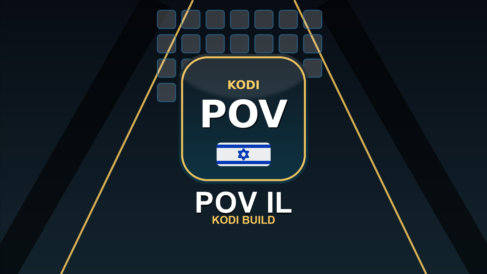

  

<h1 align="center">Kodi POV IL</h1>

  <b>הבילד הישראלי ל־Kodi: סרטים, סדרות, ערוצי ישראל וכתוביות בעברית, במקום אחד.</b> 
  The Israeli Kodi build: films, series, Israeli TV and Hebrew subtitles, in one place.

  
  
  

  <a href="https://morantheking.github.io/Kodi-POV-IL/install.html"><b>📖 מדריך התקנה</b></a>
  &nbsp;·&nbsp;
  <a href="https://morantheking.github.io/Kodi-POV-IL/downloads/android-phone/">📱 טלפון / Shield</a>
  &nbsp;·&nbsp;
  <a href="https://morantheking.github.io/Kodi-POV-IL/downloads/android-tv/">📺 Android TV</a>
  &nbsp;·&nbsp;
  <a href="https://morantheking.github.io/Kodi-POV-IL/downloads/windows/">💻 Windows</a>
  &nbsp;·&nbsp;
  <a href="https://morantheking.github.io/Kodi-POV-IL/downloads/lg-tv/">🖥️ LG TV</a>

---

## ✨ מה בפנים

<table>
<tr>
<td width="50%" valign="top">

### 🎬 סרטים וסדרות
POV ו־Umbrella, מוכנים לעבודה עם TorBox ו־Real-Debrid, רשימות Trakt ו־MDBList, ושורות בית בעברית שנטענות מהר.

</td>
<td width="50%" valign="top">

### 🇮🇱 ערוצי ישראל
כאן 11, קשת 12 ועוד דרך עידן+, בשורות משלהם במסך הבית. ב־Onyx גם ה־IPTV שלכם מקבל שורה.

</td>
</tr>
<tr>
<td valign="top">

### 💬 כתוביות בעברית: MoranSubs
כתוביות אנושיות מ־Ktuvit, ‏Wizdom ו־OpenSubtitles, ותרגום AI לעברית כשאין כתובית. סנכרון אוטומטי לסרטון, ומאגר קהילתי שבו תרגום שכבר נעשה זמין מיד לכולם.

</td>
<td valign="top">

### 🧠 עברית נכונה, לא רק מתורגמת
אחרי התרגום, מודל חזק יותר עובר על כל הסרט ומתקן זכר/נקבה ויחיד/רבים. תיקון שמשנה משהו מעבר לצורת המילה נדחה.

</td>
</tr>
<tr>
<td valign="top">

### 🎨 חמישה סקינים
Nox, ‏Onyx (ממשק מימין לשמאל מלא), ‏FENtastic, ‏Arctic Fuse 3 ו־Estuary. כולם בעברית, והמעבר ביניהם נעשה מתוך הבילד.

</td>
<td valign="top">

### 👨‍👩‍👧 פרופילים ובקרת הורים
פרופיל לכל אחד בבית, פרופיל ילדים וקוד נעילה. ראו [פרופילים ובקרת הורים](PROFILES.md).

</td>
</tr>
<tr>
<td colspan="2" valign="top">

### 🔄 מתעדכן לבד
הוויזארד מוריד רק את מה שהשתנה, בלי לגעת בהגדרות שלכם. עשרת העדכונים האחרונים מופיעים במסך הבית, עם הסבר קצר בעברית על כל אחד.

</td>
</tr>
</table>

---

## 🚀 התקנה

| הדרך | למי | איך |
|---|---|---|
| **אפליקציה מוכנה** | התקנה חדשה | מורידים מ־[הגרסה האחרונה](https://github.com/MoranTheKing/Kodi-POV-IL/releases/latest): APK לאנדרואיד (64 ביט, או 32 ביט למכשירים שלא תומכים ב־64 ביט), מתקין ל־Windows או IPK ל־LG. הוויזארד בפנים ומשלים את הבילד בהפעלה הראשונה. |
| **מתוך Kodi קיים** | יש לכם Kodi 21 | מוסיפים מקור קבצים `https://morantheking.github.io/Kodi-POV-IL/wizard-new/` ומתקינים ממנו את הוויזארד, וההתקנה מתחילה לבד. [הוראות מלאות](https://morantheking.github.io/Kodi-POV-IL/install.html#filemanager). |
| **רק הכתוביות** | בלי הבילד | מתקינים את המאגר מ־`https://morantheking.github.io/Kodi-POV-IL/repo/` ומשם את MoranSubs. [הוראות](https://morantheking.github.io/Kodi-POV-IL/install.html#ai-only). |

לתרגום AI צריך מפתח Gemini חינמי משלכם. [איך משיגים אחד](https://morantheking.github.io/Kodi-POV-IL/install.html#gemini).

---

## 📚 תיעוד

- [מדריך התקנה](https://morantheking.github.io/Kodi-POV-IL/install.html) כולל פתרון תקלות
- [פרופילים ובקרת הורים](PROFILES.md)
- [מה נשמר בעדכון ובמעבר בין גרסאות](userdata/README.md)
- [התקנות ושחרור גרסאות (APK, Windows, webOS)](APK_RELEASE.md)
- [אבטחת הריפו](SECURITY.md)
- [הערות טכניות והיסטוריית הבילד](docs/DEVELOPMENT.md), למפתחים

---

## ⚖️ רישיון

| רכיב | רישיון |
|---|---|
| **MoranSubs** (`service.subtitles.kodipovilai`) | [GNU GPL v3.0 ומעלה, עם תנאי ייחוס](service.subtitles.kodipovilai/LICENSE.txt): כל עותק חייב להשאיר "MoranSubs by MoranTheKing" וקישור לכאן, וגרסה ששונתה חייבת לציין זאת ואסור לה להשתמש בשם MoranSubs. עד 0.3.61: MIT. |
| **הוויזארד** (`plugin.program.kodipovilwizard`) | GNU GPL v3.0, כפרויקט OpenWizard שהוא מבוסס עליו |
| **הסקינים** Nox, Onyx, FENtastic, Estuary | CC BY-SA 4.0 ו־GNU GPL v2.0, כמו הסקינים שהם מבוססים עליהם |
| **שאר הבילד**: הגדרות, כלים, בדיקות, תיעוד, עמודי התקנה ותמונות | © MoranTheKing, כל הזכויות שמורות. אין להעתיק, לשנות, להפיץ או להשתמש בהם לבילד אחר בלי אישור בכתב. |

התוספים של צדדים שלישיים בבילד שייכים ליוצריהם ונשארים ברישיון שלהם. הפירוט המלא נמצא ב־[LICENSE](LICENSE).

---

## 🙏 תודות

הבילד עומד על כתפיים של אחרים:

- [Kodi](https://kodi.tv) ‏(Team Kodi)
- ‏POV ‏(kodifitzwell)
- ‏Umbrella
- עידן+ ‏(Fishenzon)
- ‏Arctic Fuse 3 ו־TMDb Helper ‏(jurialmunkey)
- ‏FENtastic ‏(Ivar Brandt) ו־Estuary ‏(phil65)
- ‏Quartz ‏(nonjon, pecinko) ו־Onyx ‏(adamsbuilds), שהסקין Onyx של הבילד מבוסס עליהם
- ‏OpenWizard ‏(drinfernoo), שהוויזארד מבוסס עליו
- ‏PyXBMCt ‏(Roman V.M.)
- ‏DarkSubs
- [SRT AI Translator NG](https://github.com/Akila3/SRT-AI-Translator-NG) ‏(Akila3)

Kodi POV IL · MoranTheKing

